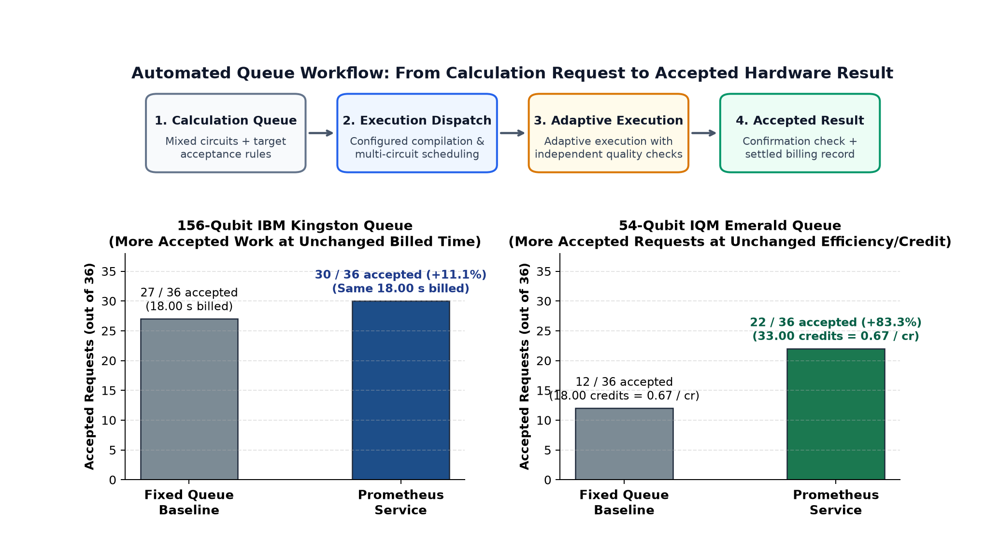

# Automated Queue Management and Execution on Quantum Hardware

*Explore the portfolio: [Prometheus Quantum Overview](https://github.com/PrometheusDynamicsCanada/prometheus-quantum-overview)*

**Prometheus manages a queue of quantum calculations, deciding how to run them and when enough measurements have been collected.**

Running a shared queue of small calculations with fixed settings leaves processor capacity unused when circuits run one at a time, degrades accuracy when incompatible circuits are packed blindly, and overspends measurements after an answer has settled. In a 72-request live hardware queue test (`36` unseen requests per provider), the billing effect differed by platform:

- **IBM Kingston (unchanged billed time):** Prometheus completed **`30/36` vs. `27/36` accepted requests (`+11.1%` per billed second)**, including **`12/12` vs. `8/12`** strict-tier requests, at the **same `18.00` billed seconds**.
- **IQM Emerald (higher total output, unchanged efficiency per credit):** Prometheus completed **`22/36` vs. `12/36` accepted requests (`+83.3%`)**, spending **`33.00` vs. `18.00` credits** for the **same `0.67` accepted requests per credit** overall. Across live adaptive stopping, **`0` of `31`** early stops failed independent confirmation.

**[Detailed results](reports/prometheus_phase3_capstone_evidence_release.md) · [Verify the evidence](#verify-the-evidence) · [Discuss a pilot](#discuss-a-pilot)**


*Opening summary: Top - Automated queue flow (`Calculation Queue -> Execution Choice -> Quality & Stop Check -> Accepted Result`). Bottom - Separated queue economics on 156-qubit IBM Kingston (`30/36` vs. `27/36` accepted at unchanged `18.00 s` billed) and 54-qubit IQM Emerald (`22/36` vs. `12/36` accepted using `33.00` vs. `18.00` credits = unchanged `0.6667` accepted/credit).*

---

## 1. Principal Phase 3 Comparative Benchmark Tables

### Table 1: Capstone Simulated Customer-Queue Benchmark Executed on Real Quantum Hardware (`Experiment 2`, `W_P3_CustHold_001..072`, `N = 36` Benchmark Requests Across 3 Windows per Provider)

*Metric Conventions:* Classical Bhattacharyya distribution overlap is F_B = Σ_x √(P_ideal(x) · P_meas(x)) (labeled `"State Fidelity"` in Studio UI screenshots), and Squared Hellinger fidelity is F_H = F_B². Direction indicators `(↑)` and `(↓)` denote whether higher or lower values are better; winning values in each provider block are **bolded**. Job-level billing ratios (`Point Acc / Billed Unit`, `LCB Cert / Billed Unit`) are descriptive ratios of total accepted requests to total settled provider billing and are reported separately from the paired workload-level statistical hypothesis tests (N = 36) in Table 2.

| Provider & QPU | Service Policy Arm | Hardware Job IDs (`N` Jobs) | PUBs (`N`) | Physical Shots (↓) | Active QPU Time `s` (↓) | Settled Billed Cost (↓) | 2Q Gates `*(mean / median)*` (↓) | Compiled Depth `*(mean / median)*` (↓) | Overlap F_B `*(mean / median)*` (↑) | Hellinger F_H = F_B² `*(mean / median)*` (↑) | TVD `*(mean / median)*` (↓) | Shannon Entropy `bits` `*(mean / median)*` | Point Accepted Requests (↑) | LCB-Certified Requests (↑) | Point Acc / Billed Unit (↑) | LCB Cert / Billed Unit (↑) | % Delta Point Acc / Billed vs. `Arm 2` (↑) |
| :--- | :--- | :--- | :---: | :---: | :---: | :---: | :---: | :---: | :---: | :---: | :---: | :---: | :---: | :---: | :---: | :---: | :---: |
| **IBM Quantum** (`ibm_kingston`, 156Q) | **`Service_Arm_1: Prometheus_Autonomous_Service`** | 6 (`dbpfvelt7fqc7389c7o0`, `dbpfvloqtr0c738ebrl0`, `dbpfvt44148s739ui54g`, `dbpg038ou4as73ctjr60`, `dbpg0hlt7fqc7389c99g`, `dbpg0p8ou4as73ctjs1g`) | 18 | 18,432 | 10.5353 s | **18.00 s** | **61.89** / 40.5 | 131.06 / 98.5 | **0.9265** / **0.9572** | **0.8653** / **0.9162** | **0.2090** / **0.1590** | 3.0242 / 2.4352 | **30 / 36 (83.3%)** | **28 / 36 (77.8%)** | **1.6667 Acc/s** | **1.5556 Cert/s** | **+11.11%** (+21.74% LCB) |
| **IBM Quantum** (`ibm_kingston`, 156Q) | `Service_Arm_2: Best_Dev_Selected_Fixed_Policy` (`A4_Fixed_4Way`) | 6 (`dbpfuvk4148s739ui3l0`, `dbpfvhoou4as73ctjqbg`, `dbpfvpdt7fqc7389c8c0`, `dbpg00tt7fqc7389c8kg`, `dbpg0dlt7fqc7389c930`, `dbpg0lgqtr0c738ebsqg`) | **12** | **12,288** | **8.9266 s** | **18.00 s** | 63.58 / **40.0** | **121.33** / **86.5** | 0.9197 / 0.9534 | 0.8520 / 0.9089 | 0.2240 / 0.1805 | 3.0552 / 2.7429 | 27 / 36 (75.0%) | 23 / 36 (63.9%) | 1.5000 Acc/s | 1.2778 Cert/s | 0.00% *(Baseline)* |
| **IQM Resonance** (`emerald`, 54Q) | **`Service_Arm_1: Prometheus_Autonomous_Service`** *(Pre-Job 4: SubWave A+B Only)* | 6 (`01a1c53c-d0c1-7201-b23b-fa5d77e2b77d`, `01a1c53f-381b-75e8-b285-0bfb2c12679b`, `01a1c543-5c7c-71f8-ab2e-d717ed252327`, `01a1c544-142e-72ad-8c9e-911eb5f8691d`, `01a1c545-ad0e-7681-b4a5-2c4bd37cb39e`, `01a1c546-4d8d-7425-b57f-ff64698496e0`) | 24 | 12,288 | 34.0000 s | 25.50 cr | **58.42** / **34.5** | **98.72** / 82.0 | 0.8648 / 0.9105 | 0.7662 / 0.8290 | 0.3194 / 0.2812 | 3.5380 / 3.4102 | 19 / 36 (52.8%) | **12 / 36 (33.3%)** | **0.7451 Acc/cr** | 0.4706 Cert/cr | **+11.76%** (+58.33% Acc Yield) |
| **IQM Resonance** (`emerald`, 54Q) | **`Service_Arm_1: Prometheus_Autonomous_Service`** *(Full: Incl. Selective Job 4)* | 9 (6 SubWave jobs above + 3 `Job 4` retry jobs: `01a1c542-d212-7144-bbe0-ef916005fcb9`, `01a1c544-5833-7649-bbcb-33e340d17ce4`, `01a1c546-d98d-7777-89e2-cacafd2a6727`) | 35 | 17,920 | 44.0000 s | 33.00 cr | **58.42** / **34.5** | **98.72** / 82.0 | **0.8685** / **0.9152** | **0.7721** / **0.8377** | **0.3122** / **0.2701** | 3.5218 / 3.3837 | **22 / 36 (61.1%)** | **12 / 36 (33.3%)** | 0.6667 Acc/cr | 0.3636 Cert/cr | 0.00% (**+83.33% Acc Yield**) |
| **IQM Resonance** (`emerald`, 54Q) | `Service_Arm_2: Best_Dev_Selected_Fixed_Policy` (`A4_Fixed_4Way`) | 6 (`01a1c539-e6bc-706a-a57c-f8e4758c2fb8`, `01a1c53d-170d-75ed-a369-9dc7fc6b6063`, `01a1c543-34a9-7573-823a-125b0e7655be`, `01a1c543-e4e5-7367-b37f-9e5ac1c9c9e6`, `01a1c544-91c7-7715-8ae7-7d2d1fa7a228`, `01a1c545-f4e8-7464-ac4a-e48e852c9e71`) | **12** | **6,144** | **24.0000 s** | **18.00 cr** | 61.25 / 41.0 | 103.03 / **74.0** | 0.8268 / 0.8912 | 0.7074 / 0.7942 | 0.3861 / 0.3353 | 3.8120 / 3.9332 | 12 / 36 (33.3%) | 8 / 36 (22.2%) | 0.6667 Acc/cr | 0.4444 Cert/cr | 0.00% *(Baseline)* |

---

### Table 2: Cross-Module Blind Holdout Summary Across All Phase 3 Experiments (212 Disjoint Workloads)

| Phase 3 Module & Holdout Cohort | Primary Comparison (`Autonomous Policy` vs. `Baseline`) | IBM Quantum (`ibm_kingston`) Key Holdout Outcome | IQM Resonance (`emerald`) Key Holdout Outcome | Paired Statistical Evidence (`Unadjusted` / `Holm-Adjusted`) |
| :--- | :--- | :--- | :--- | :--- |
| **Stage 3.0: Measured-Cost Pilot** (`W_P3_Dev_001..008`, 2 jobs, 16 PUBs, 12,288 shots) | `k=4` Packed vs. `k=1` Isolated Billing & Overlap | 4/4 accepted (`F_B = 0.9462` *(mean)* / 0.9585 *(median)*; 4.00 s settled) | 3/4 accepted (`F_B = 0.8753` *(mean)* / 0.9036 *(median)*; 6.00 cr settled) | Provider billing estimates calibrated against measured pilot charges |
| **Exp 3: Packing-Density & Fallback Calibration** (`W_P3_Dev_009..044`, 8 jobs, 272 PUBs, 209,920 shots) | `k in {2,3,4,6,8}` vs. Matched-Subgraph `k=1` Controls | **`k=8` `F_B = 0.9642` *(mean)* (48/48 accepted**, +0.00154 vs. matched `k=1` 0.9627) | **`k=4` (`4Q-7Q`): `F_B = 0.9085` *(mean)* (35/48 accepted)**; `k=6` (`7Q-9Q`, adjacent control): `F_B = 0.846034` (16/24) stepped down to **`k=3`: `F_B = 0.857180` (18/24 accepted, +0.00275 vs. `k=1`)** | Development-selected execution policy frozen before holdout testing (internal placement & grouping rules withheld) |
| **Exp 1: Prospective Policy Selector** (`W_P3_ModHold_001..036`, 26 bench jobs, 491 PUBs, 377,856 shots) | `A6_Prospective_Selector` vs. Separately Billed `A1..A5` | **5.20 Acc/s (26/36 acc / 5.00 s)**, **2.40x** vs. `A1_SABRE` (2.17 Acc/s) & **2.08x** vs. `A2_TKET` (2.50 Acc/s) | **3.11 Acc/cr (14/36 acc / 4.50 cr)**, **+8.89%** vs. Dev-selected `A4` (2.86 Acc/cr); `A3_Prometheus_1x` 22/36 acc | IQM `A6` vs. `A5_SABRE` Δ F_B = +0.03303 (`p = 0.0032`, **Holm `p = 0.0096`**); vs. `A4` Δ F_B = +0.01615 (`p = 0.0314`, Holm `p = 0.0627`) |
| **Exp 4: Telemetry Refresh Policy** (`W_P3_ModHold_037..048`, 12 jobs, 192 PUBs, 147,456 shots) | `C_Triggered_Refresh_Policy` vs. `C1_Stale`, `C2_Remap`, `C3_Fresh`, `C4_Switch` | Retained 12/12 cached T_0 circuits (**10/12 accepted**, `F_B = 0.9215` *(mean)* / 0.9236 *(median)*), cutting live CPU time by **-75.6%** vs. `C3` | `C2_Placement_Remap` raised yield **`5/12 -> 7/12`** (`F_B: 0.8485 -> 0.8641`); `C_Triggered` reached **`F_B = 0.8658`** (6/12 acc) | Demonstrated selective `C1/C2/C3` refresh without blind recompilation |
| **Exp 5: Sequentially Valid Live Stopping** (`W_P3_ModHold_049..060`, 24 bench jobs, 214 PUBs, 210,176 shots) | `S2_Adaptive_1x` & `S3_Adaptive_4x` (256..2,048 shots) vs. `S1_Fixed_2048` + 1,024 Confirm | **`S3_Adaptive_4x`: -68.75% Stage-1 shots** (7,680 vs. 24,576), **-50.63% active QPU `s`**, **11/12 vs. 9/12 confirmed**, **+6.94% total `Conf. Acc/s`** | `S3_Adaptive_4x`: -43.33% Stage-1 shots vs. 46,080 max (26,112 vs. 24,576 `S1`), -10.88% active QPU `s`, 6/12 confirmed yield across `S1/S2/S3` | **0/31 unconfirmed false stops (`0.0% <= 5.0%`)**; IBM `S3` vs. `S1` Stage-1 Δ F_B = +0.0129 (0.9355 vs. 0.9226), Confirm Δ F_B = +0.0269 |
| **Exp 2: Simulated Customer Queue Capstone** (`W_P3_CustHold_001..072`, 27 bench jobs, 78 PUBs, 55,040 shots) | `Service_Arm_1: Autonomous_Service` vs. `Service_Arm_2: Fixed_4Way_Baseline` | **30/36 (83.3%) vs. 27/36 (75.0%) accepted** at identical **18.00 s** (**+11.11% Acc/s**, **`+21.74% LCB Cert/s`**; 12/12 vs. 8/12 in strict-policy category) | **22/36 (61.1%) vs. 12/36 (33.3%) accepted** (**+83.33% yield**; +11.76% Acc/cr pre-`Job 4`, 0.00% penalty full) | IQM Δ F_B = +0.04162 (`N=36` `p = 1.68e-6` / Holm `3.36e-6`; **`K=12` PUB-cluster CRVE `p = 0.000012`, `K=6` sub-wave `p = 0.00166`**); McNemar `(10, 0)` `p = 0.00195` (**`K=12` CRVE `p = 0.00930`, `K=6` `p = 0.01987`**) |

---

### Table 3: Cumulative 3-Phase Campaign Accounting (`Phase 1` + `Phase 2` + `Phase 3`)

| Campaign Phase | Unseen Workloads (`N`) | Provider Records (`Bench + Aux`) | Physical PUBs (`N`) | Physical Shots (`N`) | Settled Spend (`IBM s` / `IQM cr`) | Detailed Reports |
| :--- | :---: | :---: | :---: | :---: | :---: | :--- |
| **Phase 3: Autonomous Service & Capstone (`v3.1`)** | **212** (`Dev-80`, `ModHold-60`, `CustHold-72`) | **107** (99 bench + 4 warm-up + 4 troubleshoot) | **1,263** (613 IBM + 650 IQM) | **1,012,736** (620,032 IBM + 392,704 IQM) | **274.00 s** (`/ 379.00 s`) / **267.00 cr** (`/ 293.00 cr`) | [Capstone](reports/prometheus_phase3_capstone_evidence_release.md), [Exp 1/3](reports/phase3_exp1_autonomous_selector_report.md), [Exp 4](reports/phase3_exp4_telemetry_refresh_report.md), [Exp 5](reports/phase3_exp5_live_stopping_report.md), [Exp 2](reports/phase3_exp2_customer_queue_service_report.md) |
| **Phase 2: Standalone Billing, Shot Ladder & Clusters** | **96** (48 Core + 48 Extended) | **28** (28 bench, 0 aux) | **629** (335 IBM + 294 IQM) | **542,720** (336,896 IBM + 205,824 IQM) | **141.00 s** (`/ 175.00 s`) / **85.50 cr** (`vs. 84.00 cr`) | [Phase 1+2 Report](reports/prometheus_phase1_phase2_campaign_report.md), `data/phase2*.json` |
| **Phase 1: Multi-QPU Routing, Replicas & Failover** | **48** Core (`W01..W48`) | **22** (22 bench, 0 aux) | **617** (457 IBM + 160 IQM) | **538,112** (456,192 IBM + 81,920 IQM) | **129.00 s** / **47.25 cr** | [Phase 1+2 Report](reports/prometheus_phase1_phase2_campaign_report.md), `data/stage*.json` |
| **GRAND CUMULATIVE TOTALS** | **308 Disjoint Workloads** | **157 Records (149 Bench + 8 Aux)** | **2,509 PUBs** | **2,093,568 Shots** | **544.00 s IBM / 399.75 cr IQM** | [`scripts/verify_execution_service_campaign.py`](scripts/verify_execution_service_campaign.py) |

---

<details>
<summary><strong>Expand Multi-Panel Technical Campaign Figures (Experiments 1-5 & Cohort Accounting)</strong></summary>


</details>

---

## Detailed Stage & Phase Technical Reports

Full per-job hardware ledgers, cluster-robust (`CRVE`) sensitivity tables, and Phase 1-3 experimental protocols are organized in [`reports/`](reports/):
- **[Phase 3 Capstone Evidence Release](reports/prometheus_phase3_capstone_evidence_release.md)** (`212` disjoint unseen workloads, `107` provider records, `1,263` PUBs, `1,012,736` shots)
- **[Experiment 2: Simulated Customer-Queue Service Report](reports/phase3_exp2_customer_queue_service_report.md)** (`72` unseen requests across IBM Kingston & IQM Emerald, `K=12` and `K=6` cluster-aware tests)
- **[Experiment 1 & 3: Prospective Policy Selector & Packing Fallback](reports/phase3_exp1_autonomous_selector_report.md)** (`36` unseen workloads/arm + frozen execution-policy calibration)
- **[Experiment 4: Triggered Telemetry Refresh Policy](reports/phase3_exp4_telemetry_refresh_report.md)** (`-75.6%` IBM compile CPU effort; IQM placement remap)
- **[Experiment 5: Sequentially Valid Live Shot Stopping](reports/phase3_exp5_live_stopping_report.md)** (`256 -> 2,048` shot ladder, `0/31` unconfirmed stops)
- **[Phases 1 & 2 Dual-Provider Validation Reference](reports/prometheus_phase1_phase2_campaign_report.md)** (`96` unseen workloads, `50` completed jobs, `1,246` PUBs, `1,080,832` shots)

---

## Verify the Evidence

**Verification Kind:** Deterministic **outcome-ledger, provider-billing arithmetic, sequential stopping trajectory, and cluster-robust statistical (`CRVE`, exact sign-flip, paired `t`, and McNemar) audit** across 15 verification stages (requires Python 3, `numpy`, and `scipy`; zero cloud credentials):

```bash
python scripts/verify_execution_service_campaign.py
```

- **Governance & schemas:** [`PUBLIC_DISCLOSURE.md`](PUBLIC_DISCLOSURE.md) · [`DATA_DICTIONARY.md`](DATA_DICTIONARY.md) · [`REPO_SHA256_MANIFEST.json`](REPO_SHA256_MANIFEST.json)

---

## Discuss a Pilot

**Bring a representative workload and an acceptance criterion. We can compare Prometheus with your existing execution approach and measure quality, acceptance rate and charged hardware resources.**

- **Contact:** [william@prometheusdynamics.ca](mailto:william@prometheusdynamics.ca) | [prometheusdynamics.ca](https://prometheusdynamics.ca)
