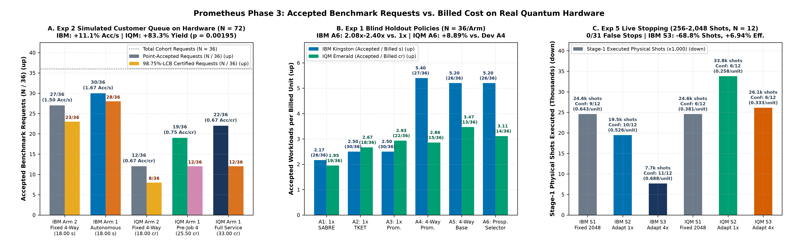
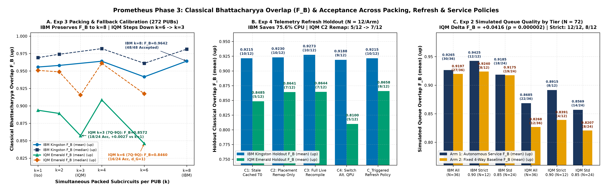
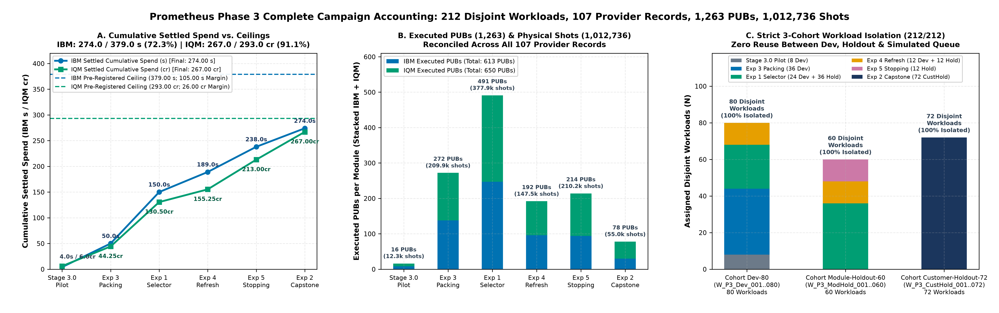

# Automated Queue Management & Live Shot Stopping

*Portfolio Hub: [Prometheus Quantum Overview](https://github.com/PrometheusDynamicsCanada/prometheus-quantum-overview) · [Phase 3 Capstone Report](reports/prometheus_phase3_capstone_evidence_release.md) · [Data Dictionary](DATA_DICTIONARY.md)*

## Introduction

- **The question:** How should a shared queue of incoming quantum jobs decide packing concurrency, calibration refreshes, and measurement stopping on live cloud hardware?
- **The test:** Across `157` provider records (`149` benchmark + `8` auxiliary jobs, `308` disjoint unseen workloads, `2,509` PUBs, `2,093,568` shots on `IBM Kingston` and `IQM Emerald`), we compared Prometheus's autonomous service policy against the best development-selected fixed `4-way` baseline on `72` unseen customer-queue requests (`36` per provider), alongside dedicated telemetry-refresh and sequential shot-stopping experiments.
- **The finding:** On `IBM Kingston`, Prometheus accepted **`30/36` vs. `27/36` requests (`+11.1%` per billed second)** at the **same `18.00` billed seconds** (`12/12` vs. `8/12` on strict-tier requests). On `IQM Emerald`, Prometheus accepted **`22/36` vs. `12/36` requests (`+83.3%` yield)** at matched `0.67` accepted/credit efficiency. Across sequential shot stopping (`256 -> 2,048` shots), **`0` of `31`** early stops failed independent confirmation (`-68.75%` Stage-1 IBM shots).
- **The significance:** Platform teams can automate multi-circuit batching and early shot termination without degrading certified output rates.
- **The boundary:** On `IQM Emerald`, adding a selective retry wave raised total accepted yield (`19 -> 22`) while increasing credit spend (`25.50 -> 33.00 cr`), matching the baseline's `0.67` accepted/credit ratio overall.
- **The evidence:** Queue workflow graphic and summary table below, with all `Phase 1-3` module tables, `CRVE` statistical tests, and offline verification underneath.

*Opening summary: Queue workflow and separated billing outcomes across 72 unseen customer requests on IBM Kingston and IQM Emerald.*

---

## Executive Summary (`Experiment 2` Simulated Customer Queue on Live Hardware, `72` Unseen Requests)

*Hardware IDs:* IBM `dbpfuvk4148s739ui3l0`..`dbpg0p8ou4as73ctjs1g` (`12` jobs); IQM `01a1c539-e6bc..`..`01a1c546-d98d..` (`15` jobs). `*(mean)*` observables shown:

| Provider & Service Policy | Accepted `(↑)` | Billed Spend `(↓)` | Acc / Billed `(↑)` | Output Agreement $F_B$ `(↑)` | Squared Hellinger $F_H$ `(↑)` | `TVD` `(↓)` | Entropy `(↓)` | `2Q` Gates / Depth `(↓)` |
| :--- | :---: | :---: | :---: | :---: | :---: | :---: | :---: | :---: |
| **IBM Kingston: Fixed `4-Way` Baseline** | `27 / 36` (`75.0%`) | **`18.00 s`** | `1.50 Acc/s` | `0.9197` | `0.8520` | `0.2240` | `3.06` | `63.58` / **`121.33`** |
| **IBM Kingston: Prometheus Service** | **`30 / 36` (`83.3%`)** | **`18.00 s`** | **`1.67 Acc/s` (`+11.1%`)** | **`0.9265`** | **`0.8653`** | **`0.2090`** | **`3.02`** | **`61.89`** / `131.06` |
| **IQM Emerald: Fixed `4-Way` Baseline** | `12 / 36` (`33.3%`) | **`18.00 cr`** | `0.67 Acc/cr` | `0.8268` | `0.7074` | `0.3861` | `3.81` | `61.25` / `103.03` |
| **IQM Emerald: Prometheus (SubWave A+B)** | `19 / 36` (`52.8%`) | `25.50 cr` | **`0.75 Acc/cr` (`+11.8%`)** | `0.8648` | `0.7662` | `0.3194` | `3.54` | **`58.42` / `98.72`** |
| **IQM Emerald: Prometheus (Full Queue)** | **`22 / 36` (`61.1%`)** | `33.00 cr` | `0.67 Acc/cr` (`+83.3%` yield) | **`0.8685`** | **`0.7721`** | **`0.3122`** | **`3.52`** | **`58.42` / `98.72`** |

*Metric Key:* Output-distribution agreement is Classical Bhattacharyya Overlap $F_B = \sum_x \sqrt{P_{\text{ideal}}(x)P_{\text{meas}}(x)}$ (labeled `"State Fidelity"` in Studio UIs); $F_H = F_B^2$. Cluster-robust IQM $\Delta F_B = +0.0416$ (`K=12` `CRVE p = 0.000012`).

---

## Inspect the Evidence & Reproduce Supported Checks Offline

- **Command:** `python scripts/verify_execution_service_campaign.py`
- **Dependencies & measured runtime:** Python 3 + `numpy` + `scipy` (`0` cloud credentials, **`~0.75 s`** measured runtime; audits `157` provider records, sequential stopping ladders, `CRVE` p-values, and SHA-256 manifests).
- **Start a pilot:** [william@prometheusdynamics.ca](mailto:william@prometheusdynamics.ca) | [prometheusdynamics.ca](https://prometheusdynamics.ca)

---

## Full Phase 1-3 Module Tables, Medians, Job IDs & Scientific Figures

<strong>1. All Phase 3 Blind Holdout Modules (212 Workloads) & Cumulative 157-Record Accounting - Click to expand</strong>

| Module & Holdout Scope | IBM Kingston Outcome | IQM Emerald Outcome | Statistical / Operational Evidence |
| :--- | :--- | :--- | :--- |
| **Stage 3.0 Pilot** (`2` jobs, `16` PUBs, `12,288` shots) | `4/4` accepted (`F_B = 0.9462` mean / `0.9585` med; `4.0 s`) | `3/4` accepted (`F_B = 0.8753` mean / `0.9036` med; `6.0 cr`) | Calibrated provider billing models |
| **Exp 3 Packing Calibration** (`8` jobs, `272` PUBs, `209,920` shots) | **`k=8` `F_B = 0.9642` (`48/48` accepted)** | **`k=4` `F_B = 0.9085` (`35/48`)**; `7Q-9Q` stepped `k=6 -> k=3` (`18/24`) | Policy frozen prior to holdouts |
| **Exp 1 Policy Selector** (`26` jobs, `491` PUBs, `377,856` shots) | **`5.20 Acc/s` (`2.40x` vs. SABRE, `2.08x` vs. TKET)** | **`3.11 Acc/cr` (`+8.89%` vs. fixed `A4`)** | IQM vs. SABRE Holm `p = 0.0096` |
| **Exp 4 Telemetry Refresh** (`12` jobs, `192` PUBs, `147,456` shots) | Retained cached `T_0` (`10/12` acc, **`-75.6%` CPU time**) | Placement remap lifted yield **`5/12 -> 7/12`** | Selective refresh without blind recompile |
| **Exp 5 Live Shot Stopping** (`24` jobs, `214` PUBs, `210,176` shots) | **`-68.75%` Stage-1 shots**, `-50.6%` active `s`, **`11/12` conf** | `-43.33%` Stage-1 shots vs. `46k` max, `6/12` conf | **`0/31` false early stops (`0.0%`)** |
| **Phase 1 + Phase 2 Foundations** (`50` jobs, `1,246` PUBs, `1,080,832` shots) | `270.0 s` settled across `96` unseen workloads | `132.75 cr` settled across routing, failover & shot ladders | [Phase 1+2 Report](reports/prometheus_phase1_phase2_campaign_report.md) |

<strong>2. Multi-Panel Campaign Figures & Stage Reports - Click to expand</strong>

